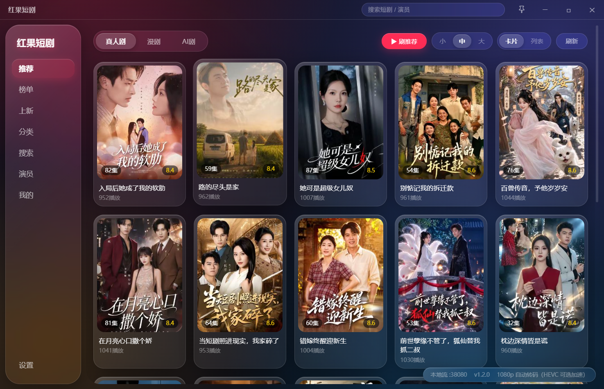
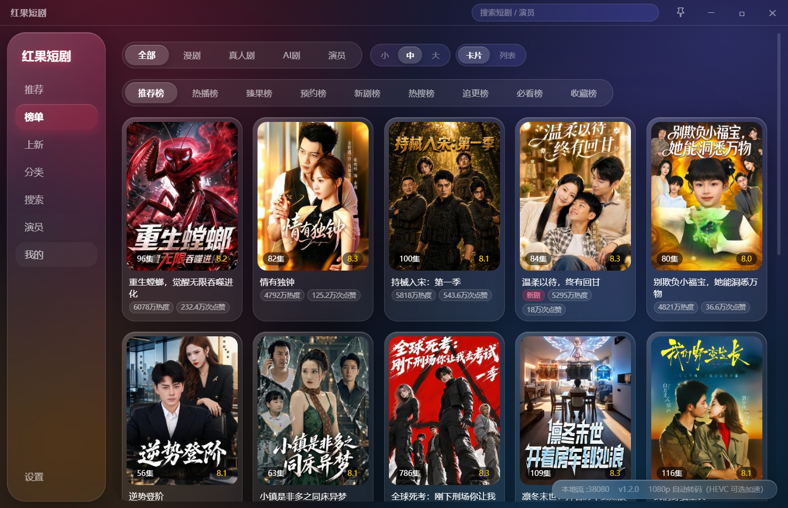
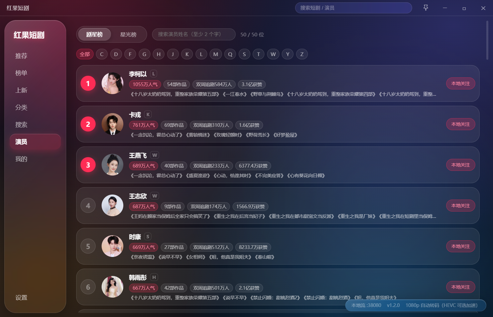
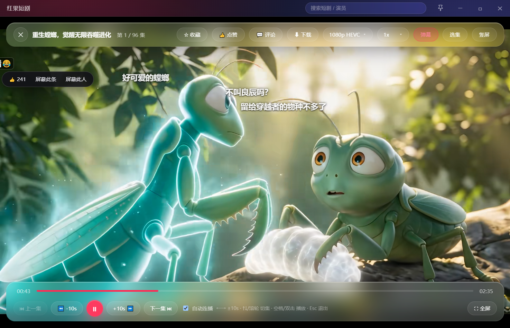

# 红果短剧 · 电脑版

在 Windows 上直接看红果短剧的桌面客户端。不用装安卓模拟器，解压或安装后双击就能用，界面是一个独立的窗口。

- 版本：以 [Releases 页面](https://github.com/SunCCity/HongGuoX/releases) 为准
- 系统要求：**Windows 10（1709 及以上）/ Windows 11，64 位**
- 分发方式：免安装压缩包，或安装包

> 非官方第三方客户端，仅供个人学习交流使用，与红果短剧官方没有任何关联。详见文末「免责声明」。

---

## 两种使用方式

### 方式一：免安装压缩包

1. 把 `HongGuo-v<版本>-windows-amd64.zip` 解压到一个**有写权限**的文件夹，例如桌面或 `D:\红果短剧`；
2. 请完整解压，不要只把 `红果短剧.exe` 单独拷出来，同目录的其它文件要一起保留；
3. 双击 `红果短剧.exe` 启动。

在这种便携模式下，你的配置就保存在**程序同目录的 `config.json`**，整个文件夹可以拷到 U 盘或另一台电脑继续用。首次启动会用 `config.example.json` 生成你自己的 `config.json`。

不要把压缩包解压到 `Program Files`、`C:\Windows` 这类没有写权限的位置，否则程序无法在本地保存配置和缓存。

### 方式二：安装包

1. 双击 `HongGuo-v<版本>-windows-amd64-setup.exe`；
2. 按向导下一步，安装位置可以默认也可以自选；
3. 按需勾选创建桌面快捷方式，完成安装；
4. 从桌面或开始菜单启动。

默认装到当前用户目录，不需要管理员权限。卸载在「设置 → 应用」里操作，也可以从开始菜单选卸载；卸载时会询问是否保留个人配置。

### 第一次打开

- 程序没有厂商数字签名，SmartScreen 可能提示「Windows 已保护你的电脑」，点「更多信息 → 仍要运行」即可；
- 极少数精简系统缺少浏览组件，运行安装目录里的 `MicrosoftEdgeWebview2Setup.exe` 补上（需要联网），装完再启动；
- 首次启动会在程序目录生成 `data`、`downloads` 等文件夹，用来放设置、缓存和下载的视频。

---

## 功能

### 首页推荐

*首页推荐：真人剧 / 漫剧 / AI 剧切换，卡片与列表两种视图，右上角可直接搜索。*

### 榜单

- 短剧主榜共 **9 个榜单**：推荐榜、热播榜、臻果榜、预约榜、新剧榜、热搜榜、追更榜、必看榜、收藏榜；
- 另有 **漫剧 / 真人剧 / AI 剧** 三个分组，每组各有自己的推荐、热播、新剧等榜单，切换分组即可。

*榜单页：9 个短剧榜 + 漫剧 / 真人剧 / AI 剧分组，封面大小可切换。*

### 演员

- 演员榜分 **剧星榜 / 星光榜** 两个榜；
- 支持按姓名搜索演员（至少两个字），搜索历史单独保存，不和短剧搜索混在一起；
- 点进演员可以看简介和参演作品，支持「本地关注」，关注列表在「我的 → 关注」里；
- 评论区、剧评里点作者头像或昵称，也能打开本地用户主页并关注。

*演员页：剧星榜 / 星光榜，支持姓名搜索与首字母筛选，可一键本地关注。*

### 搜索

- 顶部搜索框输入即搜，停手约 0.3 秒给出联想结果，可用键盘上下选择；
- 支持「猜你想搜」，点「换一批」轮换推荐词；
- 自动保存**搜索历史**，可单条删除；
- 提供**精确搜索**开关：打开后只返回标题完全一致的短剧，关闭则显示模糊结果。

### 我的（资料库）

入口在「我的」，六个分类：**历史、收藏、点赞、追更、预约、关注**，外加**下载**。

- 历史记录播放进度（秒级保存），再次进入可从上次的位置继续；本地进度与云端进度取较新的一份，旧进度不会覆盖新进度；
- **收藏夹**可以新建、重命名、删除，支持批量加入、移动、移出，也能一次性批量清理收藏 / 历史 / 点赞 / 追更 / 预约 / 关注；
- 收藏、点赞、追更、预约、收藏夹会同步到账号（登录后）；云端写入失败时保留本地并给出提示，不会丢数据；
- 顶部是账号卡片：扫码登录或手机号短信登录，登录后显示昵称、用户 ID、性别、签名、生日、会员与近 7 天活跃；上游标记资料编辑维护中时会置灰并说明原因；
- 关注的是演员和评论作者，和剧集的追更分开管理；
- 资料库统一写在本地 `local_data.json`，文件损坏会自动备份后空启动，不会卡在启动画面。

### 评论、剧评与弹幕

- 评论、回复、弹幕都带头像、昵称、时间与点赞数，支持点赞、点踩（本地记录原因）、复制、删除自己的内容；
- 可切换排序：按时间、按回复数、按点赞；
- 回复按层级展开，标注「回复 @某人」，被回复者可以点头像看资料卡；
- 正文里的 @ 用户可点击跳转，标题栏「搜用户」能按昵称 / ID 检索当前已加载的用户；
- **剧评**只展示整部剧的剧评，带星级、分数与评分文案，分集评论不会混进来；支持发布、回复、点赞和删除自己的剧评；
- 官方表情两套：红果 53 个官方表情 + 抖音 214 个官方 WebP 表情，面板、正文、回复、弹幕统一显示官方图片，可右键收藏常用表情；
- 评论与剧评里的 GIF 动图会正常播放，不会被压成静态图；
- 可以在本机导入「字语小果体」等字体用于评论区显示（字体文件只留在这台电脑上，不上传）。

### 下载与离线

「我的 → 下载」是下载中心：

- 队列管理：暂停 / 继续、失败重试、批量删除、**整剧下载**，同时下载数可选 1–4；
- 下载前可选清晰度，界面会标出编码、单集大小和能否直接播放，也能设默认清晰度；
- 开始前做磁盘空间预检，写入前再检查一次，避免下到一半才失败；
- 下载时可一并保存封面、弹幕和评论，之后**不联网也能在应用内播放**；
- 可选下载后响度标准化（EBU R128，-16 LUFS，只重编码音频，不重新压画面）；
- 下载目录可设上限（5 / 10 / 20 / 50 GB 或不限制），超出后按完成时间清理最旧的任务，正在播放或占用中的文件会跳过；
- 下载列表按剧集归纳，同一部剧的集数归到同一组；
- 缓存和下载分开管理：「清除缓存」不会删除已下载的视频。

### 播放

- **倍速**：0.5x / 0.75x / 1x / 1.25x / 1.5x / 2x / 2.5x / 3x，切集或换清晰度后保持；
- **清晰度**：多档可切，播不动时会自动降档并提示；
- **弹幕**：可开关，支持透明度、字号、速度、行距、显示区域与行数调节，可按关键词屏蔽；
- **选集**：抽屉式选集，自动定位当前集，已看过的集有标记；
- **自动连播**：一集播完自动下一集；**自动下一季**：一季最后一集播完后自动接下一季第 1 集；
- **竖屏模式**：一键把窗口切成竖屏比例；竖屏最大化或窗口变宽到 900 像素以上时会自动退出竖屏；
- **下载**：当前集一键加入下载中心，也可以在下载中心整剧下载；
- **评论**：右侧面板，可按热度、时间、回复数或点赞排序；
- **全屏控制栏**：可设为自动隐藏或常显；播放期间屏幕保持唤醒；
- **快捷键**：默认 `↑↓` / `k j` 切集，`←→` / `a d` 前后 10 秒，`PageUp` / `PageDown` 或 `[` `]` 切换推荐条目，`空格` 播放暂停，`v` 竖屏，`Esc` 退出播放器；全部可在「设置 → 通用与外观 → 快捷键」里重新录制，保存后立即生效。

*播放页：倍速、清晰度、弹幕、选集与竖屏都在顶栏，底部是进度与快捷键提示。*

### 托盘与窗口

- **托盘常驻**：显示 / 隐藏 / 退出；关闭按钮可以选择退出或最小化到托盘，支持「记住我的选项」，之后可在设置里重新打开询问；
- 程序只允许开一个窗口，重复启动会激活已有窗口，不会再开第二个；
- 退出和更新重启前会主动清理托盘图标，不会留下「幽灵图标」；
- 窗口的位置、大小、是否最大化都会被记住；支持调整窗口透明度、界面缩放和 WebView GPU 开关；
- **全局老板键**：在设置里录制、保存或清除，按键冲突会提示，设置失败自动回滚旧键。

### 消息、通知与分享

- **消息中心**：下载完成、发现新版本会写入，标题栏有未读角标，支持标为已读、全部已读和清空；
- 主窗口不在前台时，右下角弹通知气泡，6 秒后自动消失，点击可打开消息中心；
- **分享深链**：`hongguo://series/<id>?ep=N`，可复制文案或链接，也能粘贴到程序里直接打开，链接里不含账号凭证。

### 设置

- 设置项按分组排列，顶部搜索框可以直接搜「主题」「缓存」「登录」等关键词定位；
- **主题**：默认、浅色、深夜蓝、暖阳四套；
- **导航栏顺序**：可以调整左侧/顶部功能 tab 的先后顺序，也能一键恢复默认；
- **界面字形**：简体 / 繁體切换，只影响显示，不改写剧名、评论和输入内容；
- **快捷键**：播放器与通用操作的按键都可以自己录；
- **数据目录**：可以选择位置，也可以把现有数据复制迁移过去（只复制不删除，可回滚）；
- **缓存**：查看并分别清理各类缓存，可设置转码缓存上限；
- **导入 / 导出设置**：导出的文件只含界面偏好与脱敏配置，不含 cookie、token 和设备身份；
- **设备身份**：可以自定义，留空的字段继续沿用自动注册的值，保存后立即生效，也支持恢复自动注册；
- **检查更新**：见下文「更新」。

---

## 视频格式兼容（不需要额外装东西）

**开箱即用，不需要安装任何播放器、解码器或系统扩展。**

- 机器支持硬件解码时，高清晰度会更流畅，耗电也更低；
- 机器解不了当前档位时，程序会自动换成兼容格式播放：首次需要等待转码（约 8–25 秒，看 CPU），有进度条也能取消，**缓存之后再看是秒开**；
- 转码会依次尝试 NVENC / QSV / AMF 硬件编码，真正不可用时回退到 CPU 编码，不会因为选了硬件编码就失败；
- 如果你希望更流畅、避免首次等待，可以安装系统提供的可选加速组件（安装包里附带了 `Microsoft.HEVCVideoExtension_2.3.8.0.AppxBundle`，双击即可安装）。**这是可选加速，不是必需依赖**，不装也能看；
- 已经装过更高版本的加速组件时，设置页会显示「已安装更高版本，无需安装」，不用重复装；
- 只有转码失败或你手动关闭了按需转码，才会提示你去装加速组件。

---

## 缓存与磁盘

- 转码缓存**默认上限 2 GB**，可以在「设置 → 播放」里调整；
- 下载目录另有独立上限（5 / 10 / 20 / 50 GB 或不限制），在「我的 → 下载」里设置；
- 转码缓存超过上限时，程序会**自己悄悄删掉最久没用过的缓存**，不弹提示、不打扰观看；
- 下载超出上限时，按完成时间清理最旧的任务；文件正被占用会跳过并保留任务记录；
- 「清除缓存」会一并清掉转码缓存，但**不会删除你手动下载的视频**，也不会动配置和观看记录；
- 转码缓存里的一集被清掉后，下次再看这一集需要重新转码一次。

---

## 更新

- 「设置 → 更新与关于」里有「检查更新」，会显示最新版本和更新内容；
- **下载渠道自选**：GitHub / Gitee 两个渠道，默认 GitHub，会记住上次选择；选中哪个就只从哪个渠道下载，失败只提示该渠道的原因，**不会自动换源**，可以自己换一个渠道后重试；
- **版本检查跟随渠道**：选 GitHub 只查 GitHub Releases，选 Gitee 只查 Gitee Releases，两者互不顶替；「更新路径」会随渠道切换，显示对应渠道的发布页；
- **断点续传**：同一渠道内下载中断后重试会接着下，不会从头再来；
- 点「下载」后先把更新包装下来，再校验大小与 SHA256，通过之后才会问你要不要安装；拿不到 SHA256 时降级为结构校验，界面会明确说明是哪种校验；
- 确认安装后**程序会自己退出，装好再重新打开新版本**，不用你自己去下载安装包、也不用手动重启；
- **安装带看门狗**：新版本启动后 60 秒内没正常起来，会自动回滚到旧版本并重新启动，不会因为一次坏更新打不开（便携 / zip 模式）；
- 更新公告是只读的，可以查看和标为已读，不会通过公告远程改动程序行为；
- 更新包放在**程序所在目录的 `updates` 文件夹**里，不占系统临时目录，方便你自己查看和清理；
- 如果程序放在 `Program Files` 这类没有写权限的位置，更新包会自动改放到你的用户目录，界面上会明确告诉你放在哪；
- 更新途中失败（断网、磁盘空间不够、程序正被占用等），**下次启动会给出提示**，不会再出现「关掉之后什么都没发生」；
- 更新只替换程序文件，**不改动 `config.json`、已下载的视频和缓存**；
- 程序放在中文名字的目录里、或者路径里有多层中文，也能正常更新；
- 如果你习惯手动覆盖升级，请保留自己的 `config.json`，删掉它等于清空本目录的个性化配置和登录状态。

**发布侧约定（维护者）**：Gitee 的 tag 形如 `version<版本>`；资产文件名必须与 GitHub 完全一致（`HongGuo-v<版本>-windows-amd64-setup.exe` / `HongGuo-v<版本>-windows-amd64.zip`），Gitee 下载地址按文件名精确展开，名字不一致会 404；两个渠道的版本号与资产内容应保持同步。

---

## 常见问题

**1. 播放卡顿、画面不流畅**

先等这次自动转码完成（有进度条），完成后再看就是秒开；也可以在播放器里手动切到较低的清晰度。若长期卡顿，可安装随包的可选加速组件，或换台性能更好的机器。

**2. 提示视频格式不支持 / 只有声音没有画面**

保持「按需转码」开启，程序会自动把当前档位转成兼容格式播放。若仍然黑屏，安装随包的可选加速组件后重启程序，或先在播放器里切到较低清晰度。

**3. 下载的视频存在哪**

在「我的 → 下载」里，下载目录默认是程序目录下的 `downloads`；设置过自定义目录就以设置为准。点任务可以直接播放，也可以打开所在文件夹。

**4. 解压后配置在哪里**

便携版就在**程序同目录的 `config.json`**。如果程序目录没有写权限，才会改用 `%APPDATA%\HongGuo\config.json`。个人数据（历史、收藏、界面设置）在 `data` 文件夹，下载的视频在 `downloads` 文件夹。

**5. 怎么彻底清除数据**

- 「设置 → 清除所有数据」会清空历史、收藏、点赞、播放设置，以及缓存和**已下载的视频**（配置文件与登录凭证会保留）；
- 想完全重来：退出程序，删除程序目录下的 `config.json`、`data`、`downloads`；
- 安装版还要再删除 `%APPDATA%\HongGuo`。

**6. 播放时提示无法连接本地播放服务**

被防火墙或杀毒软件拦截了。把程序目录加入信任列表，或允许程序访问本机网络。

**7. 杀毒软件报毒**

个人发布的小工具容易被启发式规则误报，把程序目录加入信任列表即可。

**8. 提示文件缺失或完整性校验失败**

通常是压缩包没解压完整，或者误删了随包文件。请重新下载并完整解压到新文件夹，不要只保留 exe。

**9. 关闭窗口后程序还在运行**

这是托盘常驻：在关闭确认弹窗里选「最小化到托盘」就会这样，托盘图标可以随时把它调回来或退出。想改成直接退出，在「设置 → 通用与外观 → 窗口与托盘」里重新勾选「点击关闭时先询问」，再选择退出即可。

**10. 卸载后有残留吗**

安装包卸载时会询问是否保留个人配置，默认保留。想彻底清干净，卸载后手动删除 `%APPDATA%\HongGuo` 和原安装目录；免安装版直接删整个文件夹即可。

---

## 版本

最新版本见 [GitHub Releases 页面](https://github.com/SunCCity/HongGuoX/releases) 或 [Gitee 发布页](https://gitee.com/DobleCC/HongGuoX/releases)，仅提供 Windows 64 位：

| 文件 | 体积 | 说明 |
|---|---|---|
| `HongGuo-v<版本>-windows-amd64-setup.exe` | 69,048,756 B（约 65.9 MiB） | 安装包，按向导安装 |
| `HongGuo-v<版本>-windows-amd64.zip` | 80,115,208 B（约 76.4 MiB） | 免安装压缩包，解压即用 |

两个包内容一致，按使用习惯任选其一。升级时请整体替换，不要新旧版本文件混放。

下载后可以核对 SHA256（以当前发布版本 `v1.3.0` 为例）：

| 文件 | SHA256 |
|---|---|
| `HongGuo-v1.3.0-windows-amd64-setup.exe` | `73749B926E3CA1BDCE2E674A3753DEF10CAE1426C99CA3B9CA55F9C597364724` |
| `HongGuo-v1.3.0-windows-amd64.zip` | `13E3C00F8A227BB04B8417E346AB34635D621451892994E426FC71AB1FB38813` |

本版本主要变化：

- 新增下载中心：队列、暂停/继续、失败重试、整剧下载、并发 1–4、下载清晰度选择、磁盘空间预检、断点续传，下载列表按剧集归纳；
- 支持离线观看：下载时可保存封面、弹幕与评论；可选响度标准化（EBU R128）；
- 资料库增强：收藏夹新建/重命名/删除与批量整理，历史 / 收藏 / 点赞 / 追更 / 预约 / 关注支持批量删除，播放进度秒级保存与恢复；
- 评论、剧评、弹幕补齐社交信息：头像、昵称、层级回复、@ 跳转、资料卡、GIF、两套官方表情、排序与本地字体；
- 桌面体验：托盘常驻与关闭确认、全局老板键、消息中心与右下角通知、分享深链、简繁字形、快捷键自定义、窗口位置与缩放记忆；
- 更新增强：新版本启动看门狗，60 秒内未正常启动自动回滚旧版并重启；更新公告只读；
- 播放与稳定性：前台优先调度，下载/转码为播放让路；修复托盘图标残留、退出后残留 `java.exe`、取流 200 空包长时间卡在「解析播放地址…」等问题。

---

## 免责声明

- 本项目仅供**个人学习与研究**，不用于商业用途，不允许售卖、倒卖或二次分发牟利；
- 本项目**不提供、不存储、不分发任何内容**：视频、图片、评论、弹幕均来自内容平台接口的实时返回，客户端只负责请求与展示；
- 本项目与红果短剧官方及其运营方**没有任何关联**，未获授权或认可，相关商标与内容版权归各自权利人所有；
- 请遵守所在国家或地区的法律法规以及内容平台的服务条款，因使用本项目产生的任何后果由使用者自行承担；
- 程序内置了开源视频转码组件（GPLv3），许可证全文与对应组件的获取方式见程序目录中的 `开源许可` 文件夹。
