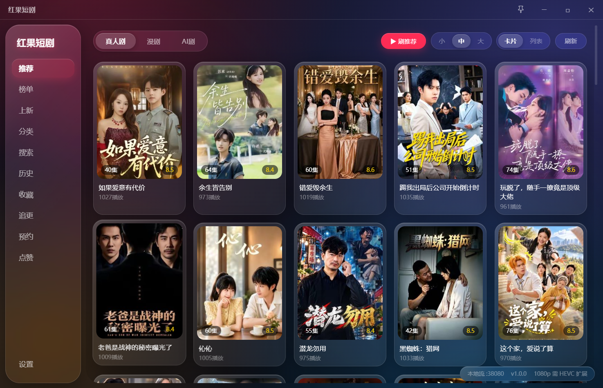

# 红果短剧 · 电脑版（HongGuo）

Windows 上直接看短剧的桌面客户端：不用装安卓模拟器，安装或解压后双击就能用，界面是一个独立的桌面窗口。

- 版本：1.0.0
- 平台：Windows 10 / 11（64 位）
- 分发：安装包，或免安装压缩包

> 这是非官方客户端，仅供个人学习研究使用，与内容平台没有任何关联。详见文末「许可与免责声明」。

---

## 简介

手机短剧放到电脑上看，通常得先装安卓模拟器，占资源、操作也别扭。本客户端把浏览、搜索、选集、播放、弹幕、评论这些操作做成一个普通的 Windows 窗口：

- 打开就是剧集列表，点开即可播放，不需要额外的播放器或运行环境；
- 支持登录账号，收藏、追更、预约可以和手机端互通；
- 所有个人数据都保存在本机，不经过第三方服务器。

---

## 功能特性

### 浏览与发现

- **推荐流**：首页按「找剧 / 漫剧」分类推荐，也可以进入全屏「刷推荐」逐条上下滑。
- **榜单、上新、分类、搜索**：四个入口都在左侧栏；分类页可以叠加多个筛选条件。
- **详情面板**：显示标题、封面、简介和分集；同一部剧的其它季也会列出，当前季播完会自动接下一季，尚未上线的季可以预约。
- **追剧、收藏、历史、点赞、预约**：默认保存在本机；登录后收藏、追更、预约可与账号同步，观看历史只保存在本机。
- **评论**：分页加载，支持楼中楼回复，可按默认、时间、回复数、点赞排序，可发带图评论，表情会自动显示成图标。
- **悬停预加载**：鼠标在卡片上停留片刻，程序会提前取回分集，点开更快。

### 播放体验

- **清晰度选择**：有多档清晰度可切换；当前档位播不动时会自动降到 720p 并提示。
- **倍速播放**：0.5x / 0.75x / 1x / 1.25x / 1.5x / 2x / 2.5x / 3x，切集或换清晰度后仍会保留。
- **选集抽屉**：默认 5 列，可在 3～8 列之间调整；打开时自动定位并高亮当前集。
- **续播与连播**：再次进入同一部剧会从上次看到的位置继续；可开启自动连播，下一集提前准备好。
- **单集下载**：把当前集下载到程序目录的 `downloads` 文件夹。
- **竖屏模式**：一键把窗口切换成竖屏比例，适合竖屏短剧，随时可退出。
- **出错有提示**：播放失败、分集为空、网络异常都会给出中文提示和「重试」按钮，不会一直转圈。
- **快捷键**：`↑↓` / `k j` / 滚轮切集，`←→` / `a d` 前后 10 秒，`PageUp/PageDown` 或 `[ ]` 切换推荐条目，`空格` 播放暂停，`v` 切竖屏，`Esc` 退出播放器。

### 弹幕

- **开关与跟随**：可随时开关弹幕；弹幕跟着画面走，暂停即停、调倍速也同步。
- **悬停操作**：鼠标停在某条弹幕上，它会停住并弹出小气泡，可以点赞、屏蔽这一条、屏蔽这个人。
- **显示调节**：透明度、字号 12～32、速度 1～10、行距 1.0～2.8、显示区域（顶部 / 中部 / 底部 / 全屏）、行数（自动或 1/2/3/4/5/6/8/10/12 行）。
- **去重与屏蔽词**：相同内容只显示一次，屏蔽词保存在本机。
- **按进度分段加载**：只取当前进度附近的弹幕，切集或拖动进度后自动补齐，不会一次拉全片。

### 内容源扩展

- **内置源**：默认就有，搜索、榜单、分集、播放、评论、弹幕都能用，无需配置。
- **本地脚本**：选择一个本机的 `.py` 脚本作为内容源。
- **在线脚本**：填写脚本网址，程序下载后加入列表。
- **手动启用**：新添加的源不会自动运行，要在列表里点「设为当前」才会生效。
- **随时切回**：任何源加载失败都可以切回内置源，基本功能不受影响。

### 设置与偏好

- **主题**：默认、浅色、深夜蓝、暖阳四套界面配色。
- **图标**：流光、极简、霓虹、单色四套内置图标主题，也可上传自己的图片（不超过 4 MB、2048×2048，大于 256 像素会自动缩小）。
- **缓存管理**：查看图片、视频、元数据缓存占用了多少空间，可单独清空；可设置自动清理天数，元数据条数上限默认 300 条，超出后自动淘汰最久未用的。
- **账号**：支持扫码登录和手机号验证码登录；退出登录会清除本机登录信息，不影响已收藏到本机的内容。
- **多套设备资料**：设置页可保存多组设备 / 会话资料，方便在不同环境下切换。
- **一键清数据**：「清除所有数据」会清空历史、收藏、点赞、播放设置与界面缓存。

---

## 截图

设置页：主题、缓存、内容源与账号设置。

---

## 下载与安装

运行环境：

- Windows 10 或 Windows 11，64 位；
- 不需要安装 Python，也不需要 JRE、模拟器或其它播放器；
- 系统若缺少「Microsoft Edge WebView2 运行组件」，用随包的 `MicrosoftEdgeWebview2Setup.exe` 补齐（在线引导器，约 1.7 MB，需联网下载）。

### 方式一：安装包（推荐）

1. 双击 `红果短剧-1.0.0-windows-amd64-setup.exe`；
2. 一路点「下一步」，安装位置可默认也可自选；
3. 按需勾选创建桌面快捷方式，完成安装；
4. 从桌面或开始菜单启动「红果短剧」。

默认安装到当前用户目录（`%LOCALAPPDATA%\HongGuo`），不需要管理员权限。卸载在「设置 → 应用」里操作，也可以从开始菜单选择卸载。

### 方式二：免安装压缩包

1. 把 `红果短剧-1.0.0-windows-amd64.zip` 解压到一个**有写权限**的文件夹，例如桌面或自己建的 `D:\红果短剧`；
2. 请完整解压，不要只把 `红果短剧.exe` 单独拷出来，同目录的其它文件需要一起保留；
3. 双击 `红果短剧.exe` 即可。

不要把压缩包直接解压到 `Program Files`、`C:\Windows` 等只读目录，否则程序无法保存配置和缓存。

### 第一次打开

- 程序是个人发布的小工具，没有厂商证书，SmartScreen 可能提示「Windows 已保护你的电脑」：点「更多信息 → 仍要运行」即可；
- 若提示缺少运行组件，先运行同目录的 `MicrosoftEdgeWebview2Setup.exe`（需联网），装完再启动程序；
- 首次启动会在程序目录创建 `data`、`downloads` 等文件夹，用来保存设置、缓存和下载内容；
- 播 1080p 短剧时如果只有声音、画面全黑，通常缺少 HEVC 视频扩展，去微软商店安装「HEVC 视频扩展」后重启程序。

---

## 快速上手

1. 打开程序，左侧选「推荐」或「搜索」，找到想看的剧；
2. 点卡片进入详情，看看简介和分集；
3. 点「播放」，或在选集抽屉里选一集；
4. 播放器内可切清晰度、调倍速、开关弹幕、打开评论、下载当前集；
5. 想换配色、调缓存或登录账号，进「设置」。

---

## 内容源（可选进阶）

默认的内置源开箱即用，下面这步只是给想换数据来源的人准备的。

| 类型 | 特点 | 怎么添加 |
|---|---|---|
| 内置源 | 功能完整，搜索、榜单、播放、评论、弹幕都有 | 无需配置，默认使用 |
| 本地源 | 用本机的一个 `.py` 脚本提供内容 | 设置 → 内容源 → 添加内容源 → 选择脚本文件 |
| 在线源 | 从一个网址下载 `.py` 脚本后使用 | 设置 → 内容源 → 添加内容源 → 填入网址 → 确认后添加 |

注意：

- **添加后不会立即运行**，需要在源列表里点「设为当前」才会生效；切换后正在播放的剧会中断，重新进入即可。
- 在线源导入后，程序会记住该脚本内容；脚本后续被改动时会要求重新确认，避免悄悄换成别的脚本。
- 脚本的运行环境已随包内置，**无需自己安装 Python**。
- 第三方脚本通常不提供评论和弹幕，此时对应入口会显示「当前内容源不提供」。
- 源加载失败时，切回「内置源」即可恢复正常使用。

---

## 配置文件与数据目录

| 路径 | 用途 | 能否删除 / 删除后会怎样 |
|---|---|---|
| `%LOCALAPPDATA%\HongGuo` | 安装包默认的安装位置 | 通过卸载删除，不建议直接删目录 |
| `<程序目录>\config.json` | 便携版配置，存在时优先使用 | 可删；删后改用用户目录下的配置 |
| `%APPDATA%\HongGuo\config.json` | 个人配置：接口地址、设备信息、登录会话、缓存目录、图标与内容源 | 可删；会丢失登录状态和个性化设置 |
| `%APPDATA%\HongGuo\credentials` | 设备凭证 | 可删；删除后可能需要重新登录或重新获取设备信息 |
| `<程序目录>\data` | 本地数据：历史、收藏、点赞、界面设置、缓存、自定义图标 | 可删；相当于清空个人数据 |
| `<程序目录>\downloads` | 视频缓存、封面缓存、接口缓存、脚本缓存、手动下载的视频 | 可删；只影响缓存和已下载文件 |
| `<程序目录>\hongguo.log` | 运行日志，超过 5 MB 会自动分成新文件 | 可删；反馈问题时可以附上它 |

配置是纯文本 JSON，设置页可以直接改。`config.example.json` 是配置模板，首次运行会据此生成个人配置。如果要把配置发给别人排查问题，**请先清空设备信息和登录凭证**，只保留脱敏后的占位值。

---

## 常见问题 FAQ

**1. exe 或文件夹图标显示的是旧图标**

Windows 资源管理器有图标缓存，换过图标后不会立刻刷新。依次尝试：

- 重启「Windows 资源管理器」；
- 以管理员身份运行 `ie4uinit.exe -show`；
- 仍不生效：关闭资源管理器进程，删除 `%LocalAppData%\Microsoft\Windows\Explorer\iconcache_*.db`，再重新打开资源管理器。

另外，程序里切换图标主题只影响窗口和任务栏图标，exe 文件本身的图标在发布时就已经固定。

**2. 播放失败，提示上游风控或空响应**

说明内容平台拒绝了这次请求。可以：

- 稍等几分钟再试，或换一部剧确认是不是单集问题；
- 在设置里换一组设备参数，保存后重新播放；
- 登录后再播放，通常比游客状态稳定；
- 提示设备未授权时，按界面说明导入设备信息文件，或重新登录。

**3. 弹幕不显示**

依次检查：弹幕开关是否打开；是否把关键词加进了屏蔽词；是否屏蔽了该条或该用户；未登录时弹幕接口可能返回错误，登录后更稳定；使用第三方内容源时，脚本本身可能不提供弹幕。

**4. 内容源加载失败**

检查脚本路径或网址是否有效、网络是否可达；在线脚本更新后需要重新确认；如果仍失败，切回「内置源」，基本功能可以立即恢复。

**5. 杀毒软件报毒或网络被拦截**

程序是个人发布的小工具，容易被启发式规则误报。请把程序目录加入杀毒软件的信任列表；播放需要访问本机网络，如果提示「无法连接播放服务」，请允许程序联网或临时关闭拦截。

**6. 只有声音、画面黑屏**

1080p 短剧常使用 HEVC 编码。请到微软商店安装「HEVC 视频扩展」，装完重启程序；也可以在播放器里切到较低的清晰度。

**7. 如何清空所有数据**

- 设置页的「清除所有数据」会清空历史、收藏、点赞、播放设置和界面缓存；
- 也可直接删除程序目录下的 `data` 与 `downloads`；
- 想彻底重来，再删除 `%APPDATA%\HongGuo`，相当于全新安装。

**8. 提示文件缺失或损坏**

通常是压缩包没有完整解压，或复制时漏掉了文件。请重新下载并完整解压到新文件夹，不要只单独保留 exe。

**9. 卸载后会不会有残留**

安装包卸载时会询问是否同时删除 `%APPDATA%\HongGuo`，默认保留。若选择保留，之后再装回来仍能看到原来的登录和设置；想彻底清干净，卸载后手动删除 `%APPDATA%\HongGuo` 和原安装目录即可。免安装版直接删除整个文件夹即可。

---

## 版本与产物

当前版本 1.0.0，仅提供 Windows 64 位版本：

| 产物 | 体积 | 说明 |
|---|---|---|
| `红果短剧-1.0.0-windows-amd64-setup.exe` | 22,010,256 B（约 21.0 MiB） | 安装包，按向导安装，适合大多数人 |
| `红果短剧-1.0.0-windows-amd64.zip` | 26,582,270 B（约 25.3 MiB） | 免安装压缩包，共 679 个条目，解压即用 |
| `红果短剧-1.0.0-windows-amd64\` | — | 解压后的目录：`红果短剧.exe`、`使用说明.txt`、`config.example.json`、`MicrosoftEdgeWebview2Setup.exe` 以及随包的运行组件 |

- 两个包内容一致，按使用习惯任选其一。
- 两个包都已包含所需的运行环境；只有当系统本身缺少运行组件时，才需要运行附带的引导器联网安装。
- 升级时请下载新版整体替换，不要新旧版本的文件混放。

---

## 致谢

感谢开源社区提供的通用组件，让这类桌面小工具更容易做出来。

---

## 许可与免责声明

- 本项目仅用于**个人学习与研究**，不用于商业用途，不允许售卖、倒卖或二次分发牟利。
- 本项目**不提供、不存储、不分发任何第三方内容**：所有视频、图片、评论、弹幕均来自内容平台接口的实时返回，客户端只负责请求与展示。
- 本项目与红果短剧官方及其运营方**没有任何关联**，未获授权或认可；相关商标与内容版权归各自权利人所有。
- 请遵守所在国家或地区的法律法规以及内容平台的服务条款；因使用本项目产生的任何后果由使用者自行承担。
- 项目当前**未附带开源许可证**，默认保留所有权利。如需正式许可协议，请由项目所有者另行补充说明。
