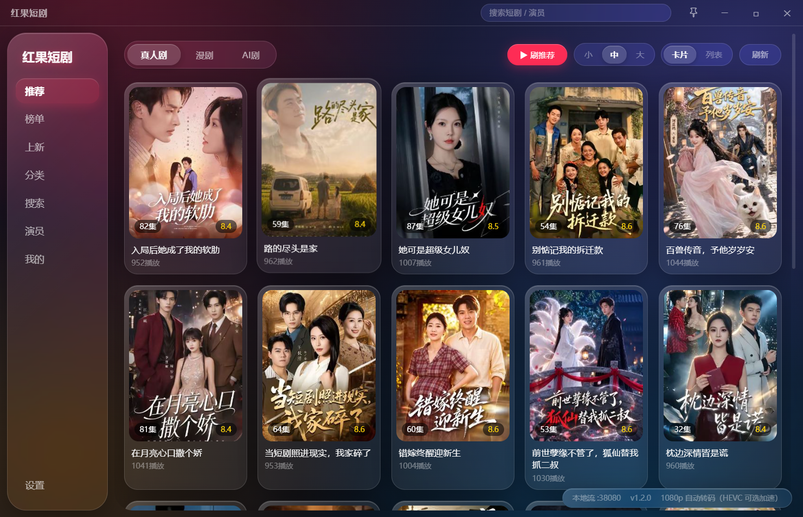
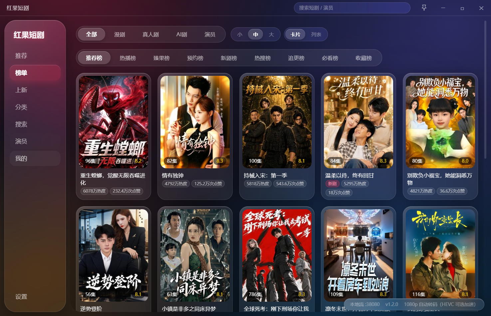
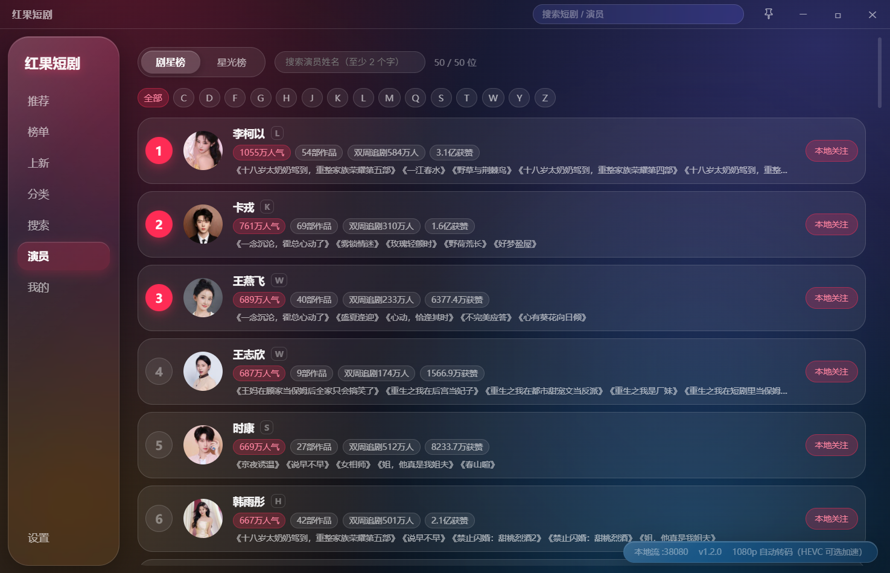
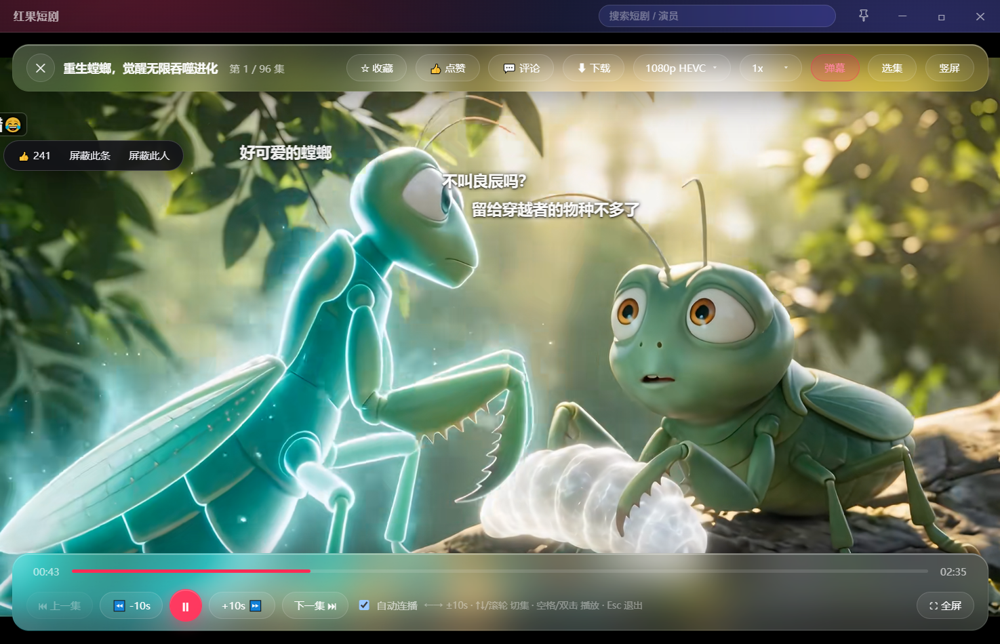

# 红果短剧 · 电脑版

在 Windows 上直接看红果短剧的桌面客户端。不用装安卓模拟器，解压或安装后双击就能用，界面是一个独立的窗口。

- 版本：**1.2.2**
- 系统要求：**Windows 10（1709 及以上）/ Windows 11，64 位**
- 分发方式：免安装压缩包，或安装包

> 非官方第三方客户端，仅供个人学习交流使用，与红果短剧官方没有任何关联。详见文末「免责声明」。

---

## 两种使用方式

### 方式一：免安装压缩包

1. 把 `红果短剧-1.2.2-windows-amd64.zip` 解压到一个**有写权限**的文件夹，例如桌面或 `D:\红果短剧`；
2. 请完整解压，不要只把 `红果短剧.exe` 单独拷出来，同目录的其它文件要一起保留；
3. 双击 `红果短剧.exe` 启动。

在这种便携模式下，你的配置就保存在**程序同目录的 `config.json`**，整个文件夹可以拷到 U 盘或另一台电脑继续用。首次启动会用 `config.example.json` 生成你自己的 `config.json`。

不要把压缩包解压到 `Program Files`、`C:\Windows` 这类没有写权限的位置，否则程序无法在本地保存配置和缓存。

### 方式二：安装包

1. 双击 `红果短剧-1.2.2-windows-amd64-setup.exe`；
2. 按向导下一步，安装位置可以默认也可以自选；
3. 按需勾选创建桌面快捷方式，完成安装；
4. 从桌面或开始菜单启动。

默认装到当前用户目录，不需要管理员权限。卸载在「设置 → 应用」里操作，也可以从开始菜单选卸载；卸载时会询问是否保留个人配置。

### 第一次打开

- 程序没有厂商数字签名，SmartScreen 可能提示「Windows 已保护你的电脑」，点「更多信息 → 仍要运行」即可；
- 极少数精简系统缺少浏览组件，运行安装目录里的 `MicrosoftEdgeWebview2Setup.exe` 补上（需要联网），装完再启动；
- 首次启动会在程序目录生成 `data`、`downloads` 等文件夹，用来放设置、缓存和下载的视频。

---

## 功能

### 首页推荐

*首页推荐：真人剧 / 漫剧 / AI 剧切换，卡片与列表两种视图，右上角可直接搜索。*

### 榜单

- 短剧主榜共 **9 个榜单**：推荐榜、热播榜、臻果榜、预约榜、新剧榜、热搜榜、追更榜、必看榜、收藏榜；
- 另有 **漫剧 / 真人剧 / AI 剧** 三个分组，每组各有自己的推荐、热播、新剧等榜单，切换分组即可。

*榜单页：9 个短剧榜 + 漫剧 / 真人剧 / AI 剧分组，封面大小可切换。*

### 演员

- 演员榜分 **剧星榜 / 星光榜** 两个榜；
- 支持按姓名搜索演员（至少两个字），搜索历史单独保存，不和短剧搜索混在一起；
- 点进演员可以看简介和参演作品，支持「本地关注」，关注列表在「我的 → 关注」里。

*演员页：剧星榜 / 星光榜，支持姓名搜索与首字母筛选，可一键本地关注。*

### 搜索

- 顶部搜索框输入即搜，支持「猜你想搜」，点「换一批」轮换推荐词；
- 自动保存**搜索历史**，可单条删除；
- 提供**精确搜索**开关：打开后只返回标题完全一致的短剧，关闭则显示模糊结果。

### 我的

六个分类：**历史、收藏、点赞、追更、预约、关注**。

- 历史记录播放进度，再次进入可从上次的位置继续；
- 收藏、追更、预约与账号同步（登录后），观看历史只保存在本机；
- 关注的是演员，和剧集的追更分开管理。

### 播放

- **倍速**：0.5x / 0.75x / 1x / 1.25x / 1.5x / 2x / 2.5x / 3x，切集或换清晰度后保持；
- **清晰度**：多档可切，播不动时会自动降档并提示；
- **弹幕**：可开关，支持透明度、字号、速度、行距、显示区域与行数调节，可按关键词屏蔽；
- **选集**：抽屉式选集，自动定位当前集，已看过的集有标记；
- **自动连播**：一集播完自动下一集；**自动下一季**：一季最后一集播完后自动接下一季第 1 集；
- **竖屏模式**：一键把窗口切成竖屏比例，适合竖屏短剧；
- **单集下载**：把当前集下载到程序目录的 `downloads`；
- **评论**：右侧面板，可按热度或时间查看回复；
- **快捷键**：`↑↓` / `k j` 切集，`←→` / `a d` 前后 10 秒，`PageUp` / `PageDown` 或 `[` `]` 切换推荐条目，`空格` 播放暂停，`v` 竖屏，`Esc` 退出播放器。

*播放页：倍速、清晰度、弹幕、选集与竖屏都在顶栏，底部是进度与快捷键提示。*

### 设置

- 设置项按分组排列，顶部搜索框可以直接搜「主题」「缓存」「登录」等关键词定位；
- **主题**：默认、浅色、深夜蓝、暖阳四套；
- **导航栏顺序**：可以调整左侧/顶部功能 tab 的先后顺序，也能一键恢复默认；
- **缓存**：查看并分别清理各类缓存，可设置转码缓存上限；
- **检查更新**：见下文「更新」。

---

## 视频格式兼容（不需要额外装东西）

**开箱即用，不需要安装任何播放器、解码器或系统扩展。**

- 机器支持硬件解码时，高清晰度会更流畅，耗电也更低；
- 机器解不了当前档位时，程序会自动换成兼容格式播放：首次需要等待转码（约 8–25 秒，看 CPU），有进度条也能取消，**缓存之后再看是秒开**；
- 如果你希望更流畅、避免首次等待，可以安装系统提供的可选加速组件（安装包里附带了 `Microsoft.HEVCVideoExtension_2.3.8.0.AppxBundle`，双击即可安装）。**这是可选加速，不是必需依赖**，不装也能看；
- 已经装过更高版本的加速组件时，设置页会显示「已安装更高版本，无需安装」，不用重复装；
- 只有转码失败或你手动关闭了按需转码，才会提示你去装加速组件。

---

## 缓存与磁盘

- 转码缓存**默认上限 2 GB**，可以在「设置 → 播放」里调整；
- 超过上限时程序会**自己悄悄删掉最久没用过的缓存**，不弹提示、不打扰观看；
- 「清除缓存」会一并清掉转码缓存；
- **清除缓存不会删除你手动下载的视频**，也不会动配置和观看记录；
- 转码缓存里的一集被清掉后，下次再看这一集需要重新转码一次。

---

## 更新

- 「设置 → 关于」里有「检查更新」，会显示最新版本和更新内容；
- 点「下载」后先把更新包装下来，再校验一遍文件是否完整，通过之后才会问你要不要安装；
- 确认安装后**程序会自己退出，装好再重新打开新版本**，不用你自己去下载安装包、也不用手动重启；
- 更新包放在**程序所在目录的 `updates` 文件夹**里，不占系统临时目录，方便你自己查看和清理；
- 如果程序放在 `Program Files` 这类没有写权限的位置，更新包会自动改放到你的用户目录，界面上会明确告诉你放在哪；
- 更新途中失败（断网、磁盘空间不够、程序正被占用等），**下次启动会给出提示**，不会再出现「关掉之后什么都没发生」；
- 更新只替换程序文件，**不改动 `config.json`、已下载的视频和缓存**；
- 程序放在中文名字的目录里、或者路径里有多层中文，也能正常更新；
- 如果你习惯手动覆盖升级，请保留自己的 `config.json`，删掉它等于清空本目录的个性化配置和登录状态。

---

## 常见问题

**1. 播放卡顿、画面不流畅**

先等这次自动转码完成（有进度条），完成后再看就是秒开；也可以在播放器里手动切到较低的清晰度。若长期卡顿，可安装随包的可选加速组件，或换台性能更好的机器。

**2. 提示视频格式不支持 / 只有声音没有画面**

保持「按需转码」开启，程序会自动把当前档位转成兼容格式播放。若仍然黑屏，安装随包的可选加速组件后重启程序，或先在播放器里切到较低清晰度。

**3. 解压后配置在哪里**

便携版就在**程序同目录的 `config.json`**。如果程序目录没有写权限，才会改用 `%APPDATA%\HongGuo\config.json`。个人数据（历史、收藏、界面设置）在 `data` 文件夹，下载的视频在 `downloads` 文件夹。

**4. 怎么彻底清除数据**

- 「设置 → 清除所有数据」会清空历史、收藏、点赞、播放设置，以及缓存和**已下载的视频**（配置文件与登录凭证会保留）；
- 想完全重来：退出程序，删除程序目录下的 `config.json`、`data`、`downloads`；
- 安装版还要再删除 `%APPDATA%\HongGuo`。

**5. 播放时提示无法连接本地播放服务**

被防火墙或杀毒软件拦截了。把程序目录加入信任列表，或允许程序访问本机网络。

**6. 杀毒软件报毒**

个人发布的小工具容易被启发式规则误报，把程序目录加入信任列表即可。

**7. 提示文件缺失或完整性校验失败**

通常是压缩包没解压完整，或者误删了随包文件。请重新下载并完整解压到新文件夹，不要只保留 exe。

**8. 卸载后有残留吗**

安装包卸载时会询问是否保留个人配置，默认保留。想彻底清干净，卸载后手动删除 `%APPDATA%\HongGuo` 和原安装目录；免安装版直接删整个文件夹即可。

---

## 版本

当前版本 **1.2.2**，仅提供 Windows 64 位：

| 文件 | 体积 | 说明 |
|---|---|---|
| `红果短剧-1.2.2-windows-amd64-setup.exe` | 38,093,917 B（约 36.3 MiB） | 安装包，按向导安装 |
| `红果短剧-1.2.2-windows-amd64.zip` | 48,355,427 B（约 46.1 MiB） | 免安装压缩包，解压即用 |

两个包内容一致，按使用习惯任选其一。升级时请整体替换，不要新旧版本文件混放。

本版本主要变化：

- 应用内更新重做：点「检查更新」下载完成后，程序会自己退出、装好并重新打开新版本；
- 更新失败不再无声无息，下次启动会直接告诉你上次没装成功，并指出问题出在哪；
- 中文目录、多层中文路径下更新恢复正常；
- 各个页面分别记住自己的滚动位置，来回切换不再互相串。

---

## 免责声明

- 本项目仅供**个人学习与研究**，不用于商业用途，不允许售卖、倒卖或二次分发牟利；
- 本项目**不提供、不存储、不分发任何内容**：视频、图片、评论、弹幕均来自内容平台接口的实时返回，客户端只负责请求与展示；
- 本项目与红果短剧官方及其运营方**没有任何关联**，未获授权或认可，相关商标与内容版权归各自权利人所有；
- 请遵守所在国家或地区的法律法规以及内容平台的服务条款，因使用本项目产生的任何后果由使用者自行承担；
- 程序内置了开源视频转码组件（GPLv3），许可证全文与对应组件的获取方式见程序目录中的 `开源许可` 文件夹。
